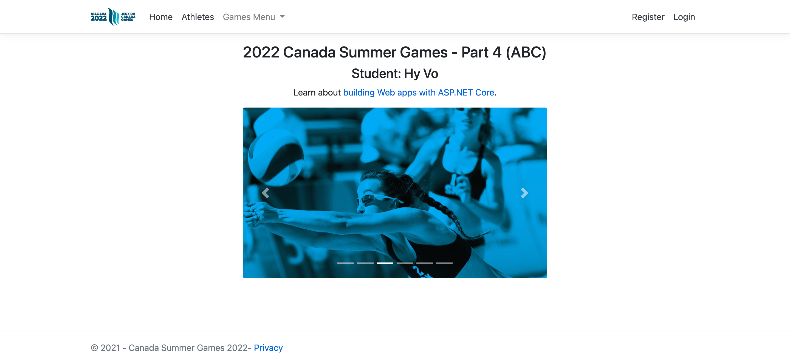
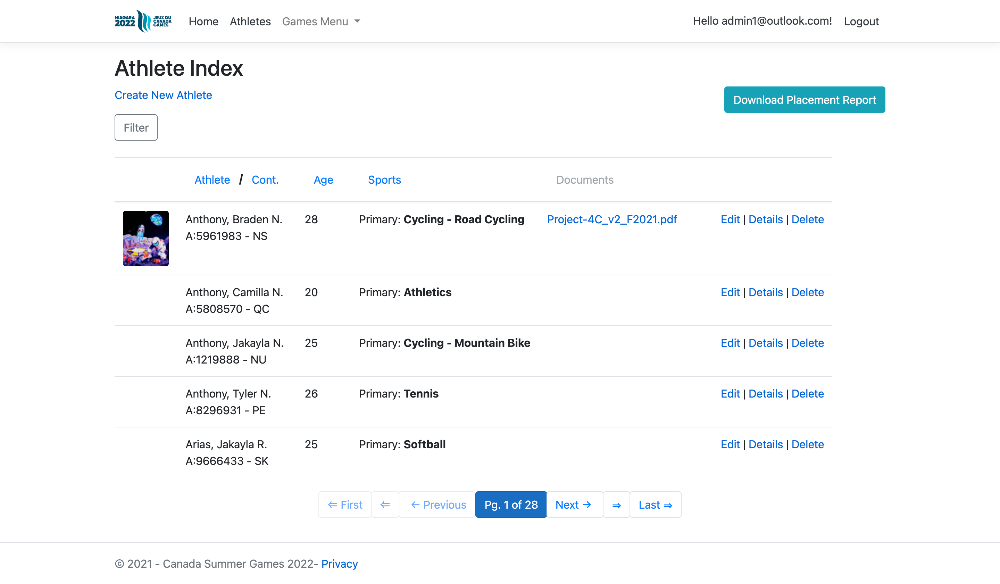
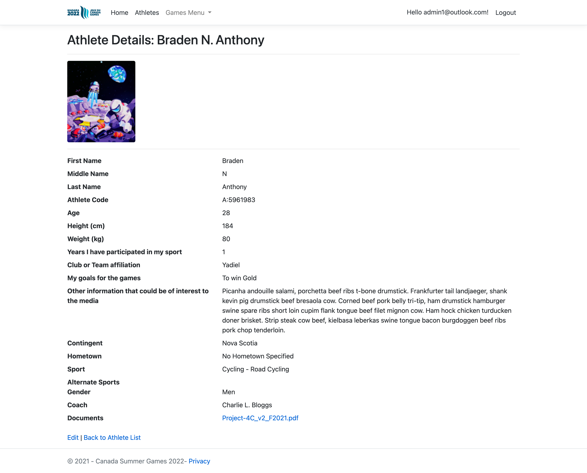

# CanadaGames

.NET 3.1 Core MVC Athlete Management App

## Installation

Install .NET 3.1 Core Runtime. Open via Visual Studios

```powershell
cd C:\Users\%user%\Documents\GitHub\MedicalOffice
dotnet run --project .\MedicalOffice\MedicalOffice.csproj --launch-profile MedicalOffice
```

- **Email:** admin1@outlook.com
- **Password:** password

## Usage

https://youtu.be/Jo53WA9WhPo

<details>
    <summary>View Screenshots</summary>
    
    
    
</details>

## Contributing

Pull requests are welcome. For major changes, please open an issue first
to discuss what you would like to change.

Please make sure to update tests as appropriate.